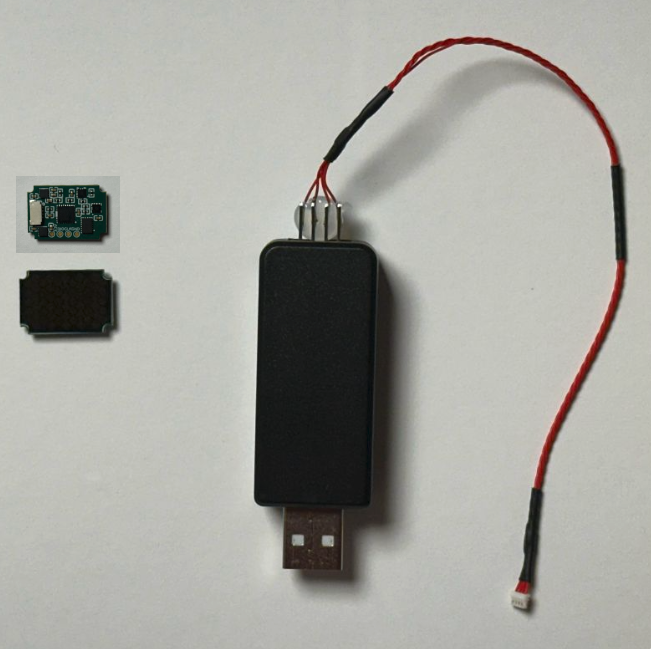
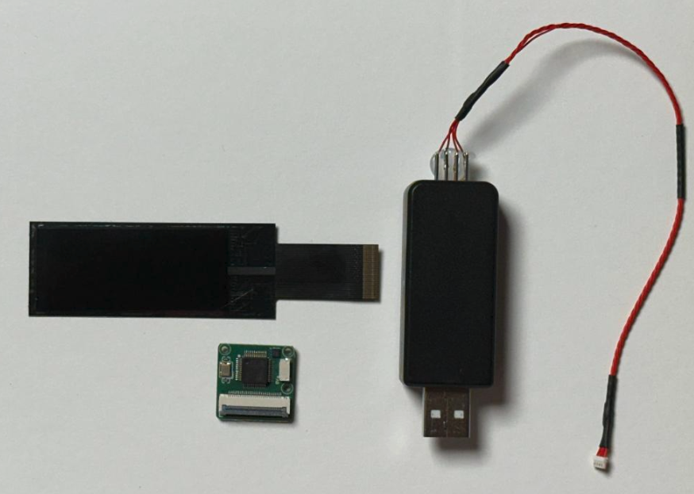
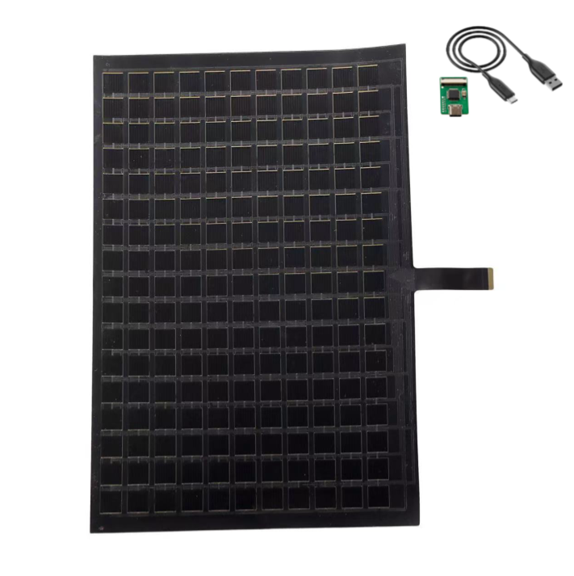
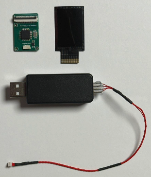
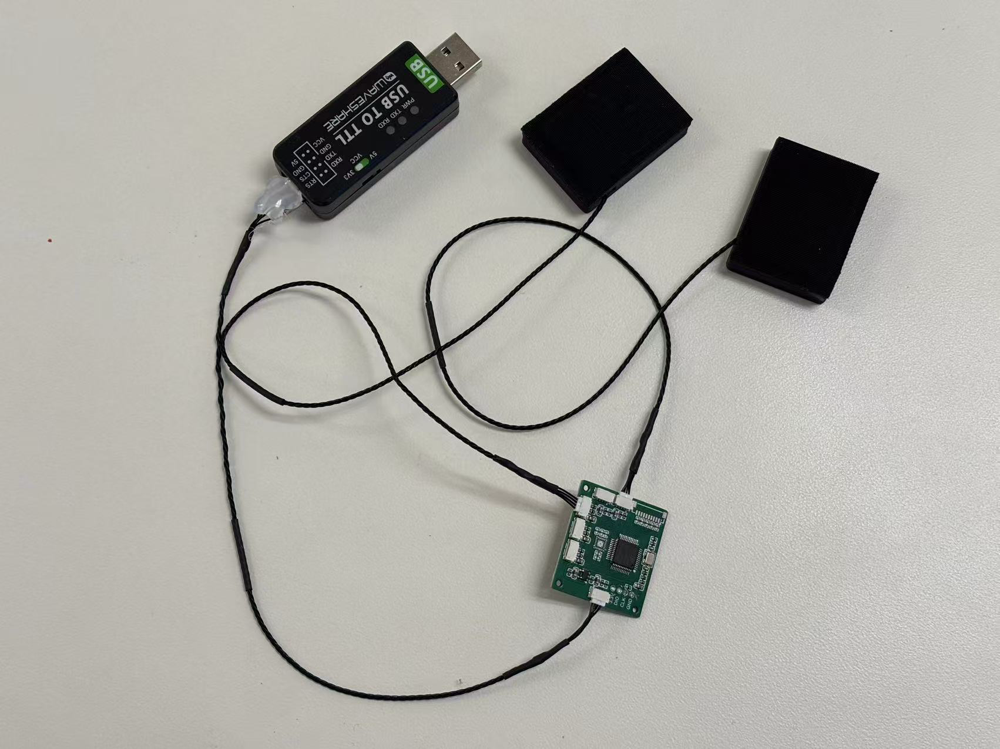
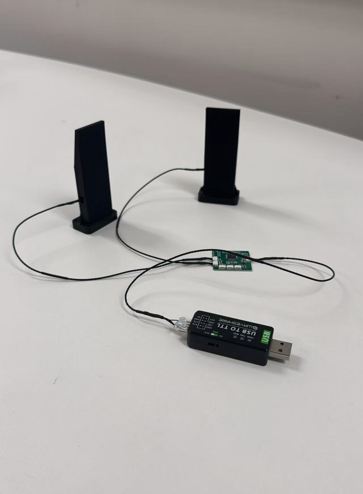

# SensX Python API

Python driver for TouchTronix tactile sensors.

## Install

```bash
cd sensx_python
pip install --upgrade pip setuptools wheel
pip install -e .
```

### Serial Permissions (Linux)

```bash
sudo chmod a+rw /dev/ttyUSB0
```

### Run Example

```bash
# Print sensor grid (default: 5x5)
python examples/stream_one.py

# Specify sensor size
python examples/stream_one.py --rows 20 --cols 8

# Measure frame rate
python examples/stream_one.py --benchmark

# Hub with two sensors
python examples/stream_hub.py --port /dev/ttyUSB0 --baud 1500000 --rows 16 --cols 12

# Hub with five SensX25 (5x5) sensors: live view, CSV recording, summary, output mode
python examples/stream_hub_5x5.py --port /dev/ttyUSB0
python examples/stream_hub_5x5.py --port /dev/ttyUSB0 --csv recording_01.csv
python examples/stream_hub_5x5.py --port /dev/ttyUSB0 --check 10
python examples/stream_hub_5x5.py --port /dev/ttyUSB0 --mode adc
```

### Supported Sensors

| Model     | Grid  | Image | Example Command |
|-----------|-------|-------|-----------------|
| SensX 25  | 5x5   |  | `python examples/stream_one.py --port /dev/ttyUSB0 --baud 921600 --rows 5 --cols 5` |
| SensX 160 | 20x8  |  | `python examples/stream_one.py --port /dev/ttyUSB0 --baud 921600 --rows 20 --cols 8` |
| SensX 187 | 17x11 |  | `python examples/stream_one.py --port /dev/ttyUSB0 --baud 921600 --rows 17 --cols 11` |
| SensX 192 | 16x12 |  | `python examples/stream_one.py --port /dev/ttyUSB0 --baud 1500000 --rows 16 --cols 12` |
| SensX 2x192 | 2x(16x12) |  | `python examples/stream_hub.py --port /dev/ttyUSB0 --baud 1500000 --rows 16 --cols 12` |
| SensX 2x160 | 2x(20x8) |  | `python examples/stream_hub.py --port /dev/ttyUSB0 --baud 921600 --rows 20 --cols 8` |
| 5 x SensX25 on a hub | 5 x (5x5) |  | `python examples/stream_hub_5x5.py --port /dev/ttyUSB0` |


## Quick Start

Blocking read:

```python
from sensx import SensX

sensor = SensX(port="/dev/ttyUSB0")
while True:
    frame = sensor.read_frame()
    print(frame)
```

Callback:

```python
from sensx import SensX

sensor = SensX(port="/dev/ttyUSB0")
sensor.on_frame = lambda frame, ts: print(frame.max())
sensor.start()
```

Callback with context manager:

```python
from sensx import SensX
import time

with SensX(port="/dev/ttyUSB0") as sensor:
    sensor.on_frame = lambda frame, ts: print(frame.max())
    sensor.start()
    time.sleep(5)
```

## API

### `SensX(port, baud_rate=15_000_000, rows=16, cols=12, init_cmd=DEFAULT_INIT_CMD)`

| Method / Property     | Description                                      |
|-----------------------|--------------------------------------------------|
| `start()`             | Start background reader thread                   |
| `stop()`              | Stop the reader thread                           |
| `close()`             | Stop and close the serial port                   |
| `read_frame()`        | Blocking read -- returns one frame (no threading)|
| `latest_frame`        | Thread-safe copy of the most recent frame        |
| `latest_timestamp`    | `time.perf_counter()` of the most recent frame   |
| `on_frame`            | Callback: `fn(frame: np.ndarray, ts: float)`     |

### `SensXHub` with five SensX25 (5x5) sensors

`SensXHub(port, baud_rate=921600, rows=5, cols=5)`

Up to five sensors on one hub, on channels A to E (frame headers `HEADER_A` = `0xAAAA`
to `HEADER_E` = `0xEEEE`). Frames from every connected sensor are delivered; an empty
connector sends nothing.

```python
from sensx import SensXHub
import time

hub = SensXHub("/dev/ttyUSB0", baud_rate=921600, rows=5, cols=5)
hub.on_frame = lambda header, frame, ts: print(header.hex(), frame.max())
hub.start()
time.sleep(5)
hub.close()
```

| Method / Property     | Description                                                        |
|-----------------------|--------------------------------------------------------------------|
| `start()`             | Start background reader thread                                     |
| `stop()`              | Stop the reader thread                                             |
| `close()`             | Stop and close the serial port                                     |
| `on_frame`            | Callback for every sensor: `fn(header: bytes, frame: np.ndarray, ts: float)` |
| `get_frame(header)`   | Latest frame of a sensor (`HEADER_A` to `HEADER_E`), or `None` before the first one |
| `connected`           | Headers of the sensors that have sent frames, e.g. `(HEADER_A, HEADER_C)` |
| `read_frame()`        | Blocking read -- returns `(header, frame)` for the next frame from any sensor (`header` is `HEADER_A` to `HEADER_E`) |
| `get_output_mode()`   | `"pressure"` or `"adc"`                                            |
| `set_output_mode(mode)` | Switch every sensor on the hub to `"pressure"` or `"adc"`        |

Use either `start()` with callbacks / `get_frame()`, or the blocking `read_frame()`, not both.

### Which sensor is which

Each channel letter belongs to a connector on the hub, not to a sensor. Seen from the
top, with the PC cable connector on the right:

```
              +----------------------+
         A ---|                      |
              |         HUB          |--- PC
         B ---|                      |
              +----------------------+
                   |      |      |
                   C      E      D
```

The bottom row reads C, E, D from left to right. A connector with no sensor sends
nothing, and the other letters stay the same. To check, run
`python examples/stream_hub_5x5.py --port <port>` and press one sensor at a time.

### Output modes (SensX25)

| Mode | Values | Notes |
|------|--------|-------|
| `pressure` | 0 to 534, kPa | Factory setting. 534 kPa is the top of the measuring range. |
| `adc` | 0 to 3945, ADC counts | The 12-bit ADC reading minus a fixed offset of 150, so an unloaded sensor reads 0 and full scale is 4095 - 150 = 3945. |

```python
hub.set_output_mode("adc")      # or "pressure"
print(hub.get_output_mode())    # "adc"
```

- The mode is stored in the sensors and kept through power-off, so it only needs to be set once.
- Through the hub, one command sets all sensors; they cannot be set individually. A sensor
  that is not connected when the mode is set keeps its old mode, so set it again after
  adding a sensor.
- `set_output_mode()` reads the mode back from every connected sensor before returning,
  and raises `RuntimeError` if that cannot be confirmed. Streaming pauses meanwhile (usually about a second).


## Performance
When testing on windows OS, in the case of Frequency drop:
1. Open device manager.
2. Navigate to the Ports and select the device, right click and open properties.


3. go to advanced under the Port Settings.
4. Change the Latency Timer (msec) to 1 and click OK.


